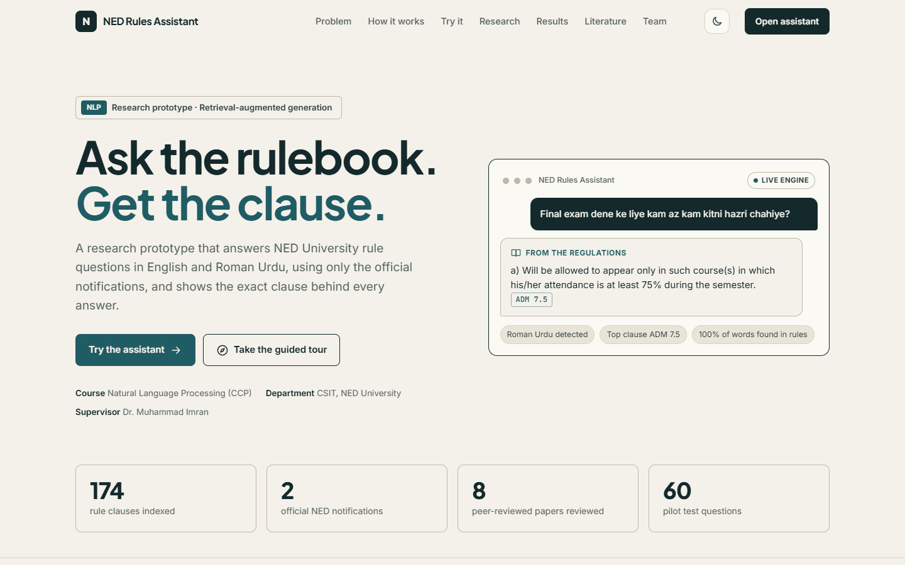
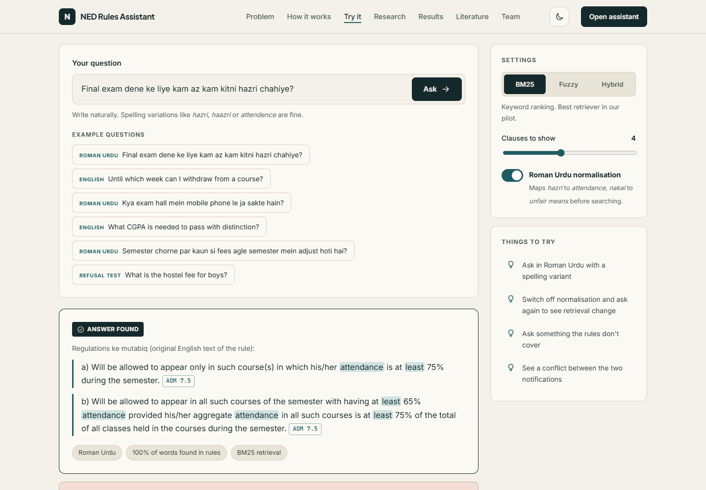

# NED Rules Assistant

A retrieval-augmented generation (RAG) prototype that answers questions about NED University's undergraduate rules in English and Roman Urdu. Every answer quotes the official clause it comes from (for example `ADM 7.5`), and the assistant says so when the rules don't cover a question instead of guessing.

This is our course research project for Natural Language Processing (CCP), BS Artificial Intelligence, Department of CSIT, NED University of Engineering and Technology, supervised by Dr. Muhammad Imran.



## Try it

Open `ui/NED_Rules_Assistant.html` in Chrome or Edge. It is one file and runs offline, with no Python and no server. The page has the assistant, a step-by-step view of the RAG pipeline, the research questions, the pilot results and a guided tour.



## How it works

1. The two official NED notifications in `ned_docs/` are split into 174 clause-sized chunks, each with its clause id and page number.
2. Roman Urdu words in the question are mapped to the English words the rules use (`hazri` to `attendance`, `nakal` to `unfair means`, `kam az kam` to `minimum least`), and filler words like `kya`, `ke liye` and `hai` are dropped.
3. A retriever ranks the clauses. We compare BM25, character n-gram TF-IDF, multilingual sentence embeddings (`paraphrase-multilingual-MiniLM-L12-v2`) and a hybrid that combines them with reciprocal rank fusion.
4. If too few of the question's words appear anywhere in the rules, the assistant refuses.
5. The answer is built only from the retrieved clauses, with the clause id after each sentence. When both notifications match a question, the assistant warns that they may differ.

The Streamlit demo can also write the answer with Claude when an Anthropic API key is set. Without a key it uses the extractive mode, which works offline. The website always uses extractive mode and does not include the embedding model.

## Research questions

- RQ1: Which retriever works best on a small set of formal regulations: BM25, dense embeddings or a hybrid?
- RQ2: Does grounding answers in the rules, with a refusal check, avoid the wrong answers a plain chatbot gives?
- RQ3: How much worse is retrieval for Roman Urdu questions, and how much of that gap does normalisation close?

## Pilot results

We wrote 25 questions in English, the same 25 in Roman Urdu, and 5 unanswerable question pairs.

- BM25 did best, with MRR@10 of 0.84 for English and 0.83 for Roman Urdu with normalisation. Without normalisation, Roman Urdu dropped to 0.63.
- Normalisation raised BM25 Recall@5 for Roman Urdu from 0.84 to 1.00.
- The dense model was weakest (MRR@10 0.58 for English). One reason is its 128-token input limit, which cuts off 46 of the 174 clauses.
- All 25 answerable questions were answered in both languages, but only 3 of 5 unanswerable questions were refused.

Full tables are in `demo/results.md`, and the method and discussion are in `report/NLP_CCP_RAG_Report.pdf`.

## Limitations

The test set is small and we wrote it ourselves, so these numbers are a pilot and not a benchmark. The Roman Urdu word list is hand-made and covers the vocabulary of these two documents. The refusal check is a word-coverage threshold, and it missed two out-of-scope questions whose words happen to appear in the rules. The rules come from notifications dated 2024 and 2025; check with the university for the current version.

## Run the Python demo

```
cd demo
pip install -r requirements.txt
python build_index.py
streamlit run app.py
```

The first run downloads the embedding model (about 470 MB). To get generated answers, set `ANTHROPIC_API_KEY` before starting the app.

To repeat the evaluation:

```
python evaluate.py
```

To rebuild the website after changing `demo/rag.py` or `demo/chunks.json`:

```
python ui/build_ui.py
```

## Repository layout

- `demo/`: Python pipeline (`rag.py`), index builder, Streamlit app, evaluation questions and results
- `ui/`: website source (`site.html`, `theme.css`, `engine.js`), build script and the built `NED_Rules_Assistant.html`
- `ned_docs/`: the two NED regulation PDFs the assistant answers from
- `report/`: report PDF, slides and the scripts that generate them
- `docs/`: screenshots for this README

## Team

- Shaikh Muhammad Zain
- Syed Mohammad Huzaifa
- Muhammad Maaz ur Rehman

## License

The code is released under the MIT License (see `LICENSE`). The regulation PDFs in `ned_docs/` are official NED University notifications and are not covered by this license.
